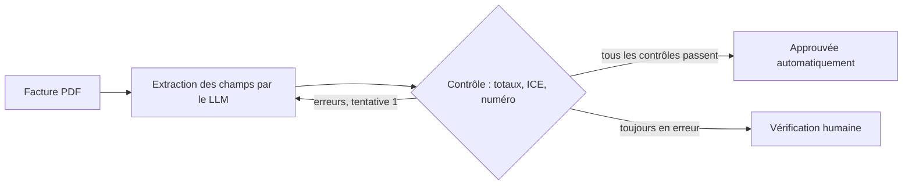
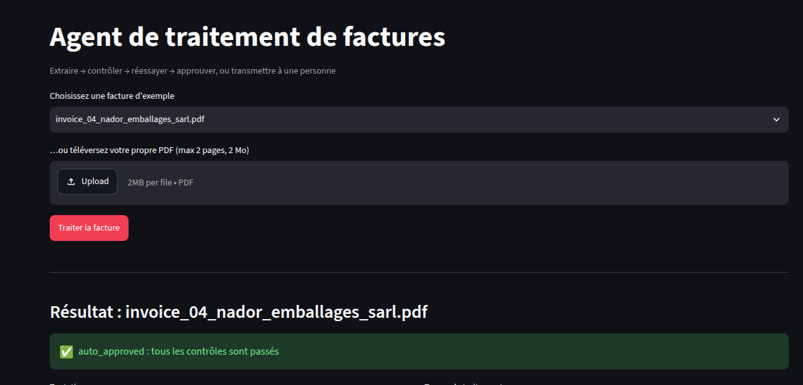
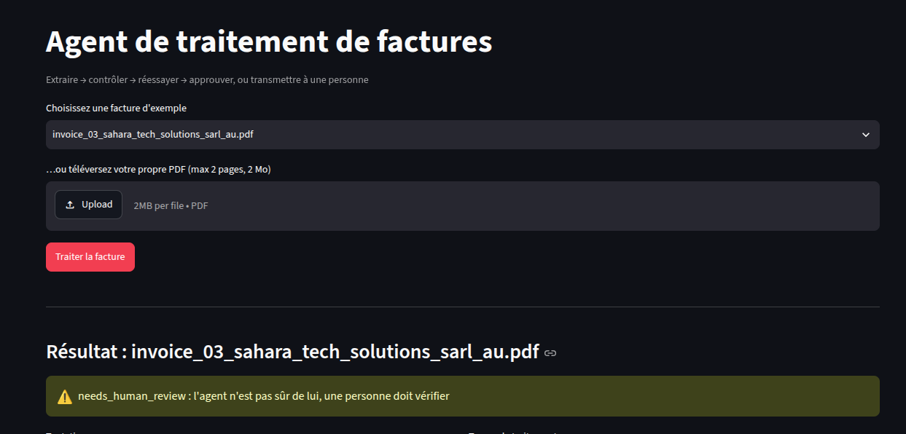
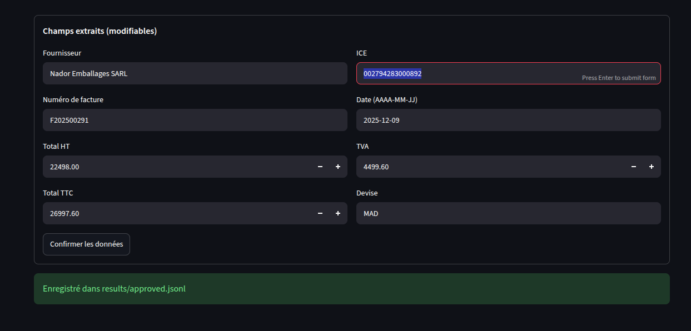

# doc-agent : un agent de factures qui sait quand ne pas se fier à lui-même

**Démo en ligne :** [___.streamlit.app](https://doc-agent-vr8wj6s9icwoggw7afk4nv.streamlit.app) · **Vidéo de 2 min :** [voir](___)

> La démo gratuite se met en veille après une période d'inactivité : le premier chargement peut prendre quelques secondes.

## Le problème
Les équipes comptables ressaisissent à la main les données des factures. Les erreurs sur les totaux et sur l'identifiant fiscal (ICE) passent à travers et coûtent des heures à retrouver. La plupart des démos d'« extraction par IA » sont impressionnantes jusqu'au jour où un total ne tombe pas juste.

## La solution
Un agent construit autour du **contrôle**, pas seulement de l'extraction :



Quand un contrôle échoue, les erreurs sont renvoyées au LLM pour une tentative d'auto-correction. Si la facture reste erronée, l'agent **ne devine pas** : il la transmet à une personne, qui corrige les champs dans un formulaire et valide.

## Résultats (12 factures marocaines synthétiques, dont 3 volontairement erronées)

| Indicateur | Version 1 | Version finale |
|---|---|---|
| Précision des champs | 97,9 % (94/96) | **100 %** (96/96) |
| Factures erronées envoyées en vérification humaine | 1 / 3 | **3 / 3** |
| Factures conformes envoyées en vérification à tort | 0 / 9 | 0 / 9 |
| Approuvées automatiquement | 11 / 12 | 9 / 12 |
| Plantages | 0 | 0 |

**Ce que montrent ces chiffres.** Dans la version 1, deux factures erronées ont été approuvées automatiquement avec une donnée fausse (un total TTC incorrect, un ICE de la mauvaise longueur). Après la correction des règles de contrôle, ces deux factures sont transmises à une personne. Le taux d'approbation automatique baisse (11 → 9 sur 12), et c'est voulu : une approbation automatique sur une facture fausse coûte plus cher qu'une vérification humaine.

**Traitement par lots en asynchrone** (12 factures, concurrence 4, 3 exécutions) :

| Exécution | Séquentiel | Asynchrone | Accélération |
|---|---|---|---|
| 1 | 80,9 s | 20,5 s | × 3,9 |
| 2 | 86,6 s | 19,6 s | × 4,4 |
| 3 | 74,9 s | 20,6 s | × 3,6 |

Accélération médiane : **× 3,9**.

**Limites à connaître.** Le jeu de test est synthétique (généré avec une vérité terrain connue) et petit (12 factures). Les règles de contrôle ont été corrigées après avoir observé les erreurs de la version 1 sur ces mêmes factures : le résultat de 100 % n'est donc pas une mesure sur des données jamais vues. La précision en conditions réelles doit être mesurée sur les propres documents de chaque client.





## Architecture et technologies
- **Orchestration :** machine à états LangGraph (extraction → contrôle → nouvel essai → aiguillage)
- **Contrôle :** schéma Pydantic + règles métier en Python (HT + TVA = TTC, ICE de 15 chiffres, numéro de facture présent)
- **LLM :** API compatible OpenAI, configurée par variables d'environnement (Gemini Flash pour les mesures ci-dessus ; OpenAI ou Ollama en local possibles)
- **Texte des PDF :** PyMuPDF
- **Interface :** Streamlit (français / anglais), avec un formulaire de vérification humaine modifiable
- **Traitement par lots :** asyncio avec un sémaphore pour respecter les limites de débit
- **Déploiement :** Streamlit Community Cloud, clés API dans les secrets de l'application

## Lancer en local
```bash
git clone https://github.com/Acherouid/doc-agent && cd doc-agent
pip install -r requirements.txt   # puis copiez .env.example vers .env et ajoutez votre clé
streamlit run app.py
```

Pour reproduire les mesures : `python eval.py` (précision) et `python batch.py` (temps de traitement).

## Ce que j'ajouterais pour la production
- OCR pour les PDF scannés (modèle de vision ou Tesseract `fra+ara`)
- Journal d'audit et base de données pour les données approuvées (sur la démo, `results/approved.jsonl` n'est pas conservé entre deux redémarrages)
- File de tâches (Celery + Redis) pour les gros volumes
- Un jeu d'évaluation plus large, construit à partir des documents réels du client, avec une partie réservée aux tests uniquement
- Détection des factures en double et vérification de l'ICE du fournisseur

## Licence
MIT
